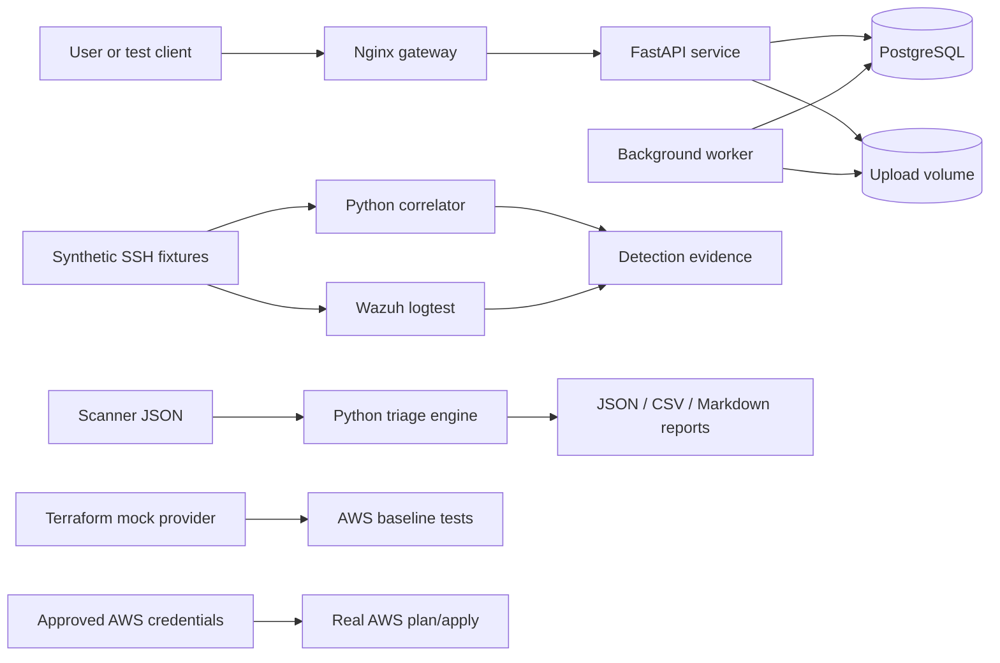

# Security Engineering Capabilities Lab

A fully executable portfolio demonstrating how defensive security controls are
designed, implemented, tested, operated and evidenced.

The repository keeps detection engineering as its core and adds the adjacent
capabilities repeatedly requested by enterprise and MSME buyers: Python security
automation, AWS foundational security, and secure software delivery.

## Capability status

| Phase | Capability | Executable evidence | Status |
| --- | --- | --- | --- |
| 0 | Repository integrity and responsible use | structure validator, licence, security policy, CI | complete |
| 1 | SSH compromise detection | Python correlation engine, Wazuh rules, positive/negative fixtures | production candidate |
| 2 | Python vulnerability triage automation | pip-audit/Trivy/Grype/Checkov parsers, deduplication, scoring, reports | validated |
| 3 | AWS foundational security | Terraform module, credential-free mock-provider tests, real-account path | validated as IaC |
| 4 | Secure SDLC reference service | FastAPI, JWT, RBAC, uploads, worker, PostgreSQL, audit events, Nginx | validated in tests |

`production candidate` and `validated` do not imply deployment in a maintained
customer production environment.

## Architecture



## Fastest path: Docker

Prerequisites: Docker Engine with Compose v2, GNU Make, `curl` and Python 3 for
the smoke-test response parsing.

```bash
cp .env.example .env
# Change APP_SECRET_KEY and APP_ADMIN_PASSWORD before sharing the lab.
make full-demo
```

`make full-demo` executes:

1. the FastAPI/PostgreSQL/background-worker smoke test;
2. the Python detection and vulnerability-triage demos in containers;
3. CycloneDX SBOM generation with Syft;
4. Wazuh decoder and correlation tests in the pinned Wazuh container; and
5. Terraform mock-provider tests without AWS credentials.

Individual commands:

```bash
make up                 # API at http://localhost:8080; direct API at :8000
make smoke              # authenticated API, RBAC, upload and worker flow
make docker-demo        # phases 1 and 2 in containers
make sbom               # CycloneDX repository SBOM
make wazuh-test         # Wazuh rule replay
make terraform-test     # phase 3 without AWS credentials
make down
```

OpenAPI is available at `http://localhost:8000/docs` in development mode.

## VirtualBox

Prerequisites: VirtualBox and Vagrant.

```bash
vagrant up --provider=virtualbox
```

The VM installs Docker, builds the core stack and forwards:

- host `18080` → Nginx gateway
- host `18000` → FastAPI

Run all phases inside the VM:

```bash
vagrant ssh
cd /workspace
make full-demo
```

The VM defaults to 4 vCPUs and 6 GB memory. Override with `LAB_CPUS` and
`LAB_MEMORY_MB`. Docker image pulls, Wazuh startup, SBOM generation and Terraform provider downloads require
internet access.

## Local Python development

```bash
make setup
source .venv/bin/activate
make validate
make demo
```

Generated evidence is written under `lab-output/` and is intentionally excluded
from source control.

## Phase 1 — detection engineering

The package at
[`detections/linux/ssh/ssh-bruteforce-followed-by-success`](detections/linux/ssh/ssh-bruteforce-followed-by-success/)
contains the threat hypothesis, telemetry contract, Python reference engine,
Wazuh decoders/rules, Sigma artefacts, tests, tuning guidance and analyst runbook.

```bash
make detection-demo
make wazuh-test
```

## Phase 2 — security automation

The triage engine accepts representative JSON produced by pip-audit, Trivy,
Grype and Checkov. It normalises records, merges scanner duplicates and assigns a
transparent risk score using severity, exploitation, exposure, environment,
criticality and fix availability.

```bash
make triage-demo
# or in Docker
make docker-demo
```

Outputs:

```text
lab-output/triage/findings.json
lab-output/triage/findings.csv
lab-output/triage/report.md
```

## Phase 3 — AWS security

The Terraform baseline enables encrypted evidence storage, CloudTrail,
GuardDuty, Security Hub, Inspector, Config, ECR enhanced scanning, alert routing,
an IAM password policy and optional VPC Flow Logs.

```bash
make terraform-fmt
make terraform-validate
make terraform-test
```

A real apply requires a dedicated AWS lab account, short-lived credentials and
explicit review. See [`terraform/aws-foundation`](terraform/aws-foundation/).

## Phase 4 — secure SDLC

The sample service demonstrates:

- Argon2 password hashing and short-lived JWT access tokens
- role-based access control
- size-limited and content-validated file uploads
- non-guessable storage names and restrictive file permissions
- a database-backed background-processing queue
- SHA-256 evidence and a harmless lab quarantine marker
- structured database and JSONL audit events
- Nginx request limiting and security headers
- non-root, read-only application containers
- automated integration tests

The safe marker is not antivirus. Production systems should integrate an
approved malware-scanning service and isolation boundary.

## AWS cost and account safety

Do not run `make aws-apply` in an established account without reviewing singleton
services, existing trails, Config recorders, delegated administrators and costs.
The module defaults `force_destroy` to false. Organisation design, IAM Identity
Center, root MFA, SCPs, log-archive accounts and cross-account aggregation are
explicitly outside the disposable baseline.

## Responsible use

All attack telemetry is synthetic and bounded to the lab. Do not use the
repository against third-party systems. See [`SECURITY.md`](SECURITY.md).
