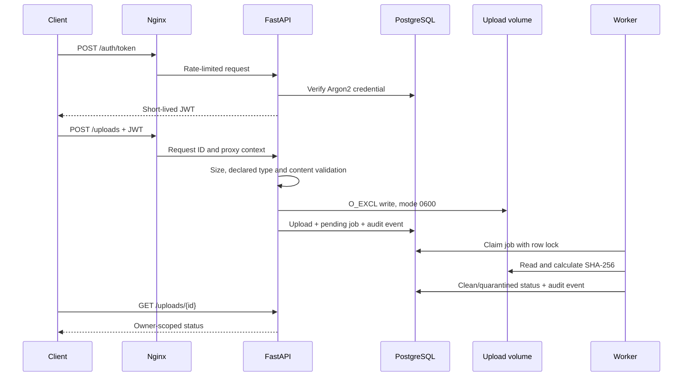

# Lab 04 — FastAPI secure-SDLC reference service

## Start

```bash
cp .env.example .env
make up
make smoke
```

The gateway is available on `http://localhost:8080`, and direct OpenAPI
documentation is exposed on `http://localhost:8000/docs` in development mode.

## Data flow



## Demonstrated controls

- authentication and role-based authorisation
- object-level ownership checks
- input, size and content validation
- safe storage path construction
- asynchronous processing separated from the request
- audit trail for login, identity and upload operations
- container least privilege
- gateway rate limiting and headers
- repeatable integration tests

See `threat-model.md`, `security-requirements.md`, `abuse-cases.md` and
`release-gates.md` for the SDL evidence.
